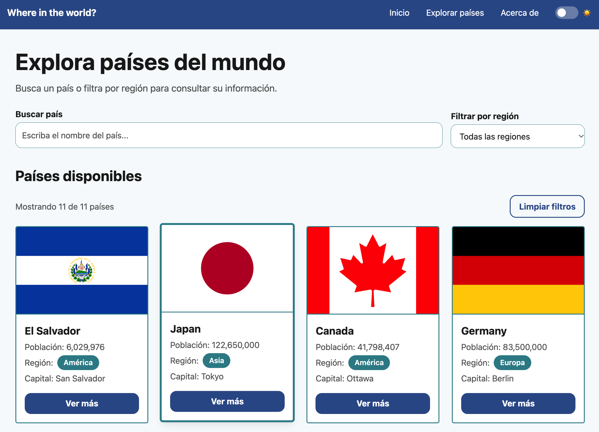
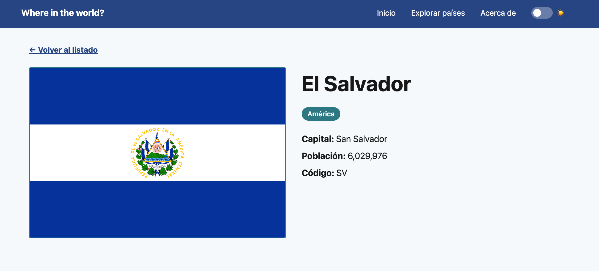

# Explorer App con React

Aplicación adaptable para explorar países, hecha con React y TypeScript siguiendo Atomic Design. Proyecto de la materia Diseño Web Adaptable (UNIVO). Muestra un listado de países con búsqueda y filtro por región, y una página de detalle para cada país.

- **Aplicación publicada:** TU-URL-DE-VERCEL
- **Versión anterior (Vanilla TypeScript):** https://github.com/Wippomonster/explore-app

## Capturas

### Listado


### Detalle de un país


## Funcionalidades

- Listado de países con bandera, nombre, población, región y capital.
- Búsqueda por nombre que se actualiza al escribir, combinada con el filtro por región.
- Botón para limpiar filtros y mensaje cuando ningún país coincide.
- Página de detalle de cada país con React Router (`/pais/:code`), con botón para volver al listado. La URL del detalle también se puede abrir directamente.
- Estados de interfaz: cargando, error (con botón para reintentar) y sin resultados.
- Diseño adaptable: cuatro tarjetas por fila en escritorio, dos en tabletas y una en móvil, con menú desplegable en pantallas pequeñas.
- Modo oscuro con interruptor, que guarda la preferencia.

## Tecnologías

- React 18 y TypeScript
- Vite
- React Router
- Tailwind CSS v4
- pnpm
- Oxlint
- Despliegue en Vercel

## Requisitos

- Node.js 22.12 o superior
- pnpm

## Cómo ejecutarlo

```bash
git clone https://github.com/Wippomonster/explorer-react.git
cd explorer-react
pnpm install
pnpm dev
```

Abre la dirección que muestra la terminal (normalmente `http://localhost:5173`).

Otros comandos:

```bash
pnpm build   # construye la versión de producción
pnpm lint    # revisa el código con Oxlint
```

## Estructura del proyecto (Atomic Design)

| Ruta | Contenido |
|---|---|
| `src/components/atoms/` | Piezas básicas: `Badge`, `Flag` |
| `src/components/molecules/` | `CountryCard`, `SearchBar`, `RegionFilter`, `ResultsBar`, `EmptyMessage`, `LoadingMessage`, `ErrorMessage`, `ThemeToggle` |
| `src/components/organisms/` | `CountryGrid`, `Header`, `SiteHeader`, `Footer` |
| `src/pages/` | Páginas de las rutas: `CountriesPage` (listado) y `CountryDetailPage` (detalle) |
| `src/hooks/` | Custom hooks: `useCountries`, `useCountryFilters`, `useDarkMode` |
| `src/types/` | Interfaces de TypeScript (`Country`) |
| `src/utils/` | `filterCountries` y funciones de formato |
| `public/countries.json` | Datos de los países que se cargan con `fetch` |

## Rutas

| Ruta | Página |
|---|---|
| `/` | Listado con búsqueda y filtro |
| `/pais/:code` | Detalle del país cuyo código alpha-2 coincide con el parámetro (por ejemplo `/pais/sv`) |

## Estado y custom hooks

- `useCountries` carga los países desde `public/countries.json` y expone `countries`, `isLoading`, `error` y `reload`.
- `useCountryFilters` guarda `query` y `region`, calcula la lista filtrada y ofrece `clearFilters`. Los componentes hijos (`SearchBar`, `RegionFilter`) no cambian el estado directamente: reciben callbacks (`onQueryChange`, `onRegionChange`) a través de `Header`.
- `useDarkMode` aplica la clase `dark` al documento y guarda la preferencia en `localStorage`.

## Mejoras realizadas en este laboratorio

- Se agregó React Router y una página de detalle por país.
- Se movió la lógica de búsqueda y filtro de `App` a custom hooks (refactor), y `App` quedó solo con las rutas y el diseño general.
- Se agregaron los estados de carga y error, además del estado vacío que ya existía.
- Se restauró el modo oscuro y el menú completo de la versión anterior.
- Se mejoraron el hover de las tarjetas y el contorno de las banderas.
- Se agregó `vercel.json` para que las URL del detalle funcionen al abrirlas directamente.

## Pendientes

- Los datos son un conjunto reducido de 11 países en un archivo local; falta conectarlos a una API real.
- Falta paginación o carga progresiva si el listado crece.